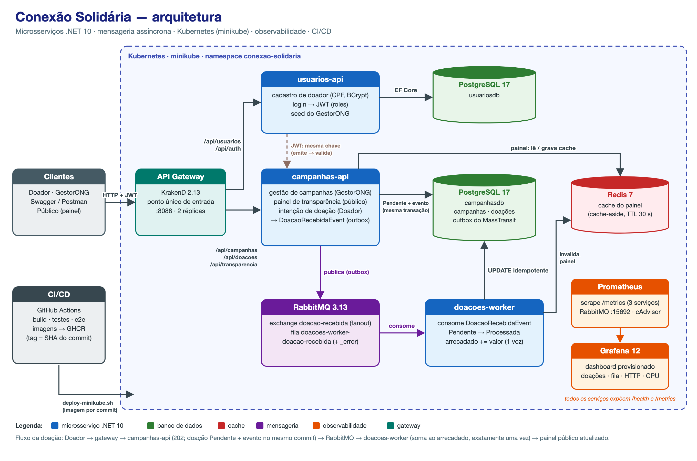

# Conexão Solidária

[](https://github.com/fcg-grupo-16/conexao-solidaria/actions/workflows/ci.yml)

MVP da plataforma digital da ONG Esperança Solidária para gestão de campanhas de arrecadação e doações — Hackathon da pós-graduação FIAP.

A plataforma permite que a ONG crie e gerencie campanhas de arrecadação, que doadores se cadastrem e doem, e que qualquer pessoa acompanhe, num painel público, quanto cada campanha já arrecadou. A doação é processada de forma **assíncrona**: a API publica um evento no RabbitMQ e um worker separado soma o valor à campanha.



| Serviço | Responsabilidade |
|---|---|
| `usuarios-api` | Cadastro público de doadores, login e emissão de JWT (roles `GestorONG` e `Doador`) |
| `campanhas-api` | Gestão de campanhas (GestorONG), painel de transparência público e intenção de doação (Doador) |
| `doacoes-worker` | Consome `DoacaoRecebidaEvent` e atualiza o valor arrecadado da campanha |
| `gateway` | API Gateway (KrakenD): ponto único de entrada |

Infraestrutura: PostgreSQL 17, Redis 7, RabbitMQ 3.13, Prometheus, Grafana — tudo em Kubernetes (minikube).

## Documentos da entrega

| Documento | Onde |
|---|---|
| Diagrama de arquitetura | [`docs/arquitetura/arquitetura.png`](docs/arquitetura/arquitetura.png) ([SVG](docs/arquitetura/arquitetura.svg)) |
| Justificativa dos bancos de dados (PDF) | [`docs/justificativa-bancos.pdf`](docs/justificativa-bancos.pdf) |
| Decisões de arquitetura (ADRs) | [`docs/adr/`](docs/adr/README.md) |
| Coleção Postman | [`docs/postman/`](docs/postman/README.md) |
| Roteiro do vídeo de demonstração | [`docs/roteiro-video.md`](docs/roteiro-video.md) |
| Template do relatório de entrega | [`docs/relatorio-entrega.md`](docs/relatorio-entrega.md) |

## Requisitos do PDF e onde estão atendidos

| Requisito | Implementação |
|---|---|
| JWT com roles `GestorONG` e `Doador`; gestão só para o gestor | `usuarios-api` emite; `campanhas-api` valida com a mesma chave e aplica as políticas (401 sem token, 403 com role errada) |
| Campanha com Título, Descrição, Datas, Meta e Status; término não no passado e meta > 0 | Agregado `Campanha` (`src/Campanhas/Campanhas.Domain`), `POST`/`PUT /api/campanhas` → 400 apontando o campo |
| Cadastro público de doador: e-mail único, CPF validado, senha com BCrypt | `POST /api/usuarios`; índice único no PostgreSQL; `Cpf` valida dígitos verificadores; BCrypt |
| Painel público só com campanhas Ativas: Título, Meta e Valor Arrecadado | `GET /api/transparencia/campanhas` (cache Redis invalidado pelo worker) |
| Doação pelo doador logado; recusa campanha encerrada ou cancelada | `POST /api/doacoes` → 202; 422 para concluída, cancelada ou fora do prazo |
| ≥ 2 microsserviços | `usuarios-api`, `campanhas-api`, `doacoes-worker` (+ gateway) |
| API **não** atualiza o arrecadado; publica evento; worker consome e atualiza | Outbox do MassTransit publica `DoacaoRecebidaEvent` no exchange `doacao-recebida`; o `doacoes-worker` consome a fila `doacoes-worker-doacao-recebida` e soma de forma idempotente |
| Kubernetes com Deployments, Services e ConfigMaps (.yaml) | [`deploy/k8s/`](deploy/k8s) |
| `/health` ou `/metrics`; Grafana com dashboard de métricas reais | `/health/live`, `/health/ready`, `/metrics` em todos; dashboard provisionado "Conexão Solidária — Visão geral" |
| CI em todo push na `main`: build e imagem Docker | [`.github/workflows/ci.yml`](.github/workflows/ci.yml): build, testes, ponta a ponta e imagens no GHCR |
| Bônus: testes de unidade no CI | 150+ testes (unidade do domínio e integração com Testcontainers) rodando no CI |
| Bônus: API Gateway | KrakenD roteando todas as rotas |

## Passo a passo para subir localmente (Kubernetes)

### 1. Pré-requisitos

- [Docker](https://docs.docker.com/get-docker/) (Docker Desktop, OrbStack ou equivalente), com pelo menos 8 GB de memória disponíveis
- [minikube](https://minikube.sigs.k8s.io/docs/start/) e [`kubectl`](https://kubernetes.io/docs/tasks/tools/)
- `git`, `curl` e `jq` (os scripts usam bash; no Windows, rode pelo WSL)
- Opcional: Postman ou Node.js (para rodar a coleção com `npx newman`)

### 2. Clonar e subir o cluster

```bash
git clone https://github.com/fcg-grupo-16/conexao-solidaria.git
cd conexao-solidaria
minikube start --cpus=4 --memory=8g
```

### 3. Implantar a plataforma

```bash
./scripts/deploy-minikube.sh
```

O script constrói as três imagens dentro do minikube com a **tag do commit**, aplica os manifestos de [`deploy/k8s/`](deploy/k8s) (Kustomize) e espera tudo ficar pronto. A primeira execução leva alguns minutos (download das imagens base e build). Ao final:

```bash
kubectl -n conexao-solidaria get pods
```

Devem aparecer 13 pods `Running` e prontos: `usuarios-api`, `campanhas-api`, `doacoes-worker` e `gateway` (2 réplicas cada), `postgres-0`, `rabbitmq-0`, `redis`, `prometheus` e `grafana`.

### 4. Acessar os serviços

Em outro terminal (deixe rodando; Ctrl+C encerra):

```bash
./scripts/port-forward.sh
```

| Serviço | Endereço |
|---|---|
| **API Gateway** (ponto único de entrada) | http://localhost:8088 |
| `usuarios-api` (Swagger) | http://localhost:5081/swagger |
| `campanhas-api` (Swagger) | http://localhost:5082/swagger |
| `doacoes-worker` | http://localhost:5083/health/ready |
| RabbitMQ Management | http://localhost:15672 (`conexao` / `conexao-demo`) |
| Grafana | http://localhost:3000 (dashboard **Conexão Solidária — Visão geral**; leitura sem login, admin `admin` / `conexao-demo`) |
| Prometheus | http://localhost:9090 |

Credenciais **de demonstração** do gestor: `gestor@esperancasolidaria.org` / `Gestor@2026`.

### 5. Testar o fluxo

**Automático** (23 verificações pelo gateway: cadastro, login, regras de negócio, doação → fila → worker → painel):

```bash
./scripts/smoke-test.sh
./scripts/verify-entrega.sh   # checklist do PDF contra o cluster
```

**Pelo Postman:** importe a coleção e o ambiente `gateway` de [`docs/postman/`](docs/postman/README.md) e rode em ordem, ou:

```bash
npx newman run docs/postman/conexao-solidaria.postman_collection.json -e docs/postman/gateway.postman_environment.json
```

**Pelo Swagger, passo a passo:**

1. `usuarios-api` → `POST /api/usuarios`: cadastre um doador (o CPF precisa ser válido, ex.: `529.982.247-25`).
2. `POST /api/auth/login` com o gestor e copie o `token`; na `campanhas-api`, clique em **Authorize** e cole o token.
3. `POST /api/campanhas`: crie uma campanha com `dataFim` no futuro e `metaFinanceira` > 0.
4. Faça login com o doador, troque o token no **Authorize** e chame `POST /api/doacoes` com o `idCampanha` e o `valorDoacao` → `202 Accepted`, status `Pendente`.
5. No RabbitMQ Management (aba **Queues**), a fila `doacoes-worker-doacao-recebida` mostra a mensagem passando (publish/ack).
6. `GET /api/transparencia/campanhas` (sem token): a campanha aparece com o valor arrecadado somado pelo worker.
7. No Grafana, o dashboard mostra a doação recebida pela API e processada pelo worker, a fila e o consumo de CPU/memória dos pods.

### 6. Remover

```bash
./scripts/undeploy-minikube.sh
minikube stop
```

### Estrutura dos manifestos

[`deploy/k8s/`](deploy/k8s) (Kustomize): namespace, ConfigMaps, Secrets, PostgreSQL e RabbitMQ (StatefulSet com volume), Redis, um Deployment + Service por serviço — APIs, worker e gateway com 2 réplicas, probes de *startup*, *readiness* e *liveness*, limites de recurso, usuário não root e sistema de arquivos somente leitura —, Prometheus e Grafana. A chave do JWT e as credenciais ficam num Secret só, referenciado por quem precisa (um valor, um lugar). Todos os valores versionados são **de demonstração**.

## Estrutura do repositório

```
src/                    código dos serviços e building blocks compartilhados
tests/                  testes de unidade e de integração
deploy/k8s/             manifestos Kubernetes, gateway (krakend.json) e observabilidade (Prometheus, Grafana)
docker-compose.yml      ambiente de desenvolvimento sem cluster
scripts/                deploy no minikube, port-forward, smoke test, verificação da entrega, documentos
docs/                   ADRs, diagrama, justificativa dos bancos, Postman e roteiro do vídeo
```

## Rodando com Docker Compose (desenvolvimento)

Pré-requisito: Docker. Sobe PostgreSQL, RabbitMQ, Redis e os três serviços:

```bash
docker compose up --build -d
docker compose ps          # infraestrutura "healthy" e serviços "running"
```

| Serviço | Endereço |
|---|---|
| **API Gateway** | http://localhost:8088 |
| `usuarios-api` | http://localhost:5081/swagger |
| `campanhas-api` | http://localhost:5082/swagger |
| `doacoes-worker` | http://localhost:5083/health/ready |
| RabbitMQ Management | http://localhost:15672 (`conexao` / `conexao-demo`) |
| PostgreSQL | `localhost:15432` (`conexao` / `conexao-demo`) |
| Redis | `localhost:16379` |

Gestor de demonstração: `gestor@esperancasolidaria.org` / `Gestor@2026`. Para exercitar o fluxo inteiro:

```bash
npx newman run docs/postman/conexao-solidaria.postman_collection.json -e docs/postman/local.postman_environment.json
```

O `./scripts/smoke-test.sh` também funciona contra o compose. Para derrubar e apagar os dados: `docker compose down -v`. Todas as credenciais versionadas são **de demonstração**.

A entrega roda no Kubernetes (minikube); o compose existe para desenvolvimento e usa as mesmas variáveis de ambiente dos manifestos.

## Desenvolvimento

Pré-requisitos: [.NET SDK 10](https://dotnet.microsoft.com/download) (versão fixada em `global.json`) e Docker (os testes de integração sobem PostgreSQL, RabbitMQ e Redis com Testcontainers).

```bash
dotnet build ConexaoSolidaria.slnx
dotnet test --solution ConexaoSolidaria.slnx --max-parallel-test-modules 1
```

Migrations do EF Core (ferramenta local fixada em `.config/dotnet-tools.json`):

```bash
dotnet tool restore
dotnet ef migrations add <Nome> -p src/Usuarios/Usuarios.Infrastructure -s src/Usuarios/Usuarios.Api -o Persistencia/Migrations
dotnet ef migrations add <Nome> -p src/Campanhas/Campanhas.Infrastructure -s src/Campanhas/Campanhas.Infrastructure -o Persistencia/Migrations
```

As APIs aplicam as migrations pendentes ao iniciar (`Banco:AplicarMigrations`, padrão `true`).

Versões de pacotes ficam centralizadas em `Directory.Packages.props`; os `.csproj` não declaram versão.

O diagrama e o PDF da justificativa dos bancos são gerados a partir das fontes versionadas (`docs/arquitetura/gerar-diagrama.py` e `docs/justificativa-bancos.md`) com `./scripts/gerar-documentos.sh` (requer Python 3, pandoc e Chrome/Chromium).

## Endpoints

| Método | Rota | Acesso | Serviço | Descrição |
|---|---|---|---|---|
| `POST` | `/api/usuarios` | público | `usuarios-api` | Cadastro de doador (e-mail e CPF únicos, senha com BCrypt) |
| `POST` | `/api/auth/login` | público | `usuarios-api` | Login; devolve JWT com a claim `role` (`GestorONG` ou `Doador`) |
| `GET` | `/api/usuarios/me` | autenticado | `usuarios-api` | Dados do dono do token |
| `GET` | `/api/usuarios/{id}` | `GestorONG` | `usuarios-api` | Dados de um usuário |
| `POST` | `/api/campanhas` | `GestorONG` | `campanhas-api` | Cria campanha (término não no passado, meta > 0) |
| `PUT` | `/api/campanhas/{id}` | `GestorONG` | `campanhas-api` | Edita dados e status (`Ativa`, `Concluida`, `Cancelada`) |
| `GET` | `/api/campanhas` | `GestorONG` | `campanhas-api` | Lista campanhas (`?status=` opcional) |
| `GET` | `/api/campanhas/{id}` | `GestorONG` | `campanhas-api` | Detalhes de uma campanha |
| `POST` | `/api/doacoes` | `Doador` | `campanhas-api` | Intenção de doação → `202 Accepted`; publica `DoacaoRecebidaEvent` |
| `GET` | `/api/transparencia/campanhas` | público | `campanhas-api` | Painel de transparência: campanhas `Ativa` com título, meta e valor arrecadado |
| `GET` | `/api/doacoes/{id}` | `Doador` (própria) ou `GestorONG` | `campanhas-api` | Status do processamento (`Pendente`, `Processada`, `Rejeitada`) |

O único `GestorONG` nasce do seed de configuração (`GestorInicial:*`); o cadastro público só cria doadores. A chave, o emissor e o público do JWT (`Jwt:*`) são os mesmos na `usuarios-api`, que emite, e na `campanhas-api`, que valida.

O `doacoes-worker` consome a fila `doacoes-worker-doacao-recebida`, soma o valor ao arrecadado da campanha **exatamente uma vez** (a transição `Pendente → Processada` é a guarda, na mesma transação do incremento atômico) e marca a doação como `Processada`, ou `Rejeitada` se a campanha foi cancelada ou concluída antes do processamento. Falhas transitórias são retentadas; as persistentes vão para a fila `_error`.

O painel é servido do Redis (*cache-aside*, TTL de 30 s) e invalidado logo depois de cada doação processada e de cada criação ou edição de campanha; o header `X-Cache` indica `HIT` ou `MISS`. Sem Redis, o painel lê direto do PostgreSQL.

A doação é assíncrona: a `campanhas-api` grava a doação como `Pendente` e o `DoacaoRecebidaEvent` no mesmo commit (outbox do MassTransit), e o evento é entregue no exchange `doacao-recebida` do RabbitMQ. A API **não** altera o valor arrecadado.

Todos os serviços expõem `/health/live`, `/health/ready` e `/metrics` (Prometheus).

## API Gateway

O [KrakenD](https://www.krakend.io/) é o ponto único de entrada (`http://localhost:8088`, no compose e no port-forward do cluster) e roteia cada rota da tabela de endpoints para a `usuarios-api` ou a `campanhas-api`. A configuração declarativa está em [`deploy/k8s/gateway/krakend.json`](deploy/k8s/gateway/krakend.json) e é a mesma nos dois ambientes. O gateway repassa o header `Authorization` e devolve as respostas sem alteração (status, `Location`, `X-Cache`, ProblemDetails); quem valida o JWT são os próprios serviços. Rota não declarada responde 404 no gateway.

## Swagger e Postman

- Swagger em `/swagger` nas duas APIs, com o botão **Authorize** para o JWT.
- Coleção Postman do fluxo completo em [`docs/postman/`](docs/postman/README.md), com um ambiente direto nos serviços e outro pelo gateway.

## Observabilidade

Cada serviço expõe:

| Endpoint | Para quê |
|---|---|
| `/health/live` | O processo responde (probe de *liveness*; não consulta dependências) |
| `/health/ready` | Dependências: PostgreSQL, RabbitMQ e Redis conforme o serviço (probe de *readiness*; `503` se uma dependência essencial cair) |
| `/metrics` | Métricas no formato Prometheus (OpenTelemetry) |

Métricas de negócio, além das HTTP (`http_server_request_duration_seconds`), do runtime .NET e do MassTransit:

| Serviço | Métrica |
|---|---|
| `usuarios-api` | `usuarios_cadastrados_total`, `usuarios_logins_total{resultado,perfil}` |
| `campanhas-api` | `doacoes_recebidas_total`, `doacoes_valor_recebido_BRL_total`, `doacoes_recusadas_total{motivo}` |
| `doacoes-worker` | `doacoes_processadas_total`, `doacoes_rejeitadas_total`, `doacoes_reentregas_ignoradas_total`, `doacoes_valor_processado_BRL_total`, `doacoes_atraso_processamento_seconds` |

No cluster, o **Prometheus** coleta os serviços (pods com a anotação `prometheus.io/scrape`), o RabbitMQ (plugin `rabbitmq_prometheus`, por fila) e o cAdvisor do kubelet (CPU e memória por pod). O **Grafana** sobe com o datasource e o dashboard **provisionados** a partir de [`deploy/k8s/observabilidade/`](deploy/k8s/observabilidade): doações recebidas × processadas, valor processado, fila do RabbitMQ e seus consumidores, atraso até o processamento, requisições/latência/status HTTP por serviço e rota, cadastros e logins, CPU e memória por pod e mensagens do MassTransit.

Na prontidão, a queda do RabbitMQ ou do Redis deixa a `campanhas-api` como `Degraded` (o outbox guarda as doações e o painel lê do banco) e o `doacoes-worker` como `Unhealthy` (sem broker ele não trabalha).

Os logs são JSON (Serilog) com o `TraceId` da requisição; o MassTransit propaga o contexto, então a doação na API e o processamento no worker compartilham o mesmo trace.

## CI/CD

O workflow [`CI`](.github/workflows/ci.yml) roda em todo PR e em todo push na `main`:

| Job | O que faz |
|---|---|
| **Build e testes** | `dotnet build` e todos os testes (unidade e integração com PostgreSQL, RabbitMQ e Redis via Testcontainers); resultados `.trx` como artefato |
| **Manifestos e scripts** | `yamllint`, `docker compose config`, `kubeconform` nos manifestos renderizados pelo Kustomize, JSON do dashboard, `shellcheck` e `krakend check` |
| **Ponta a ponta (docker compose)** | Constrói as três imagens, sobe a plataforma inteira (com o gateway), executa a coleção Postman direto nos serviços e pelo gateway, e roda o `smoke-test.sh` |
| **Imagem \<serviço\>** | Só na `main`: publica `ghcr.io/fcg-grupo-16/conexao-solidaria/<serviço>:<sha do commit>` |

A `main` é protegida: só recebe PR com os três primeiros jobs verdes.

## Decisões de arquitetura

As decisões estão registradas como ADRs em [`docs/adr/`](docs/adr/README.md): monorepo, bancos de dados (PostgreSQL + Redis), mensageria (RabbitMQ + MassTransit com outbox) e observabilidade.
